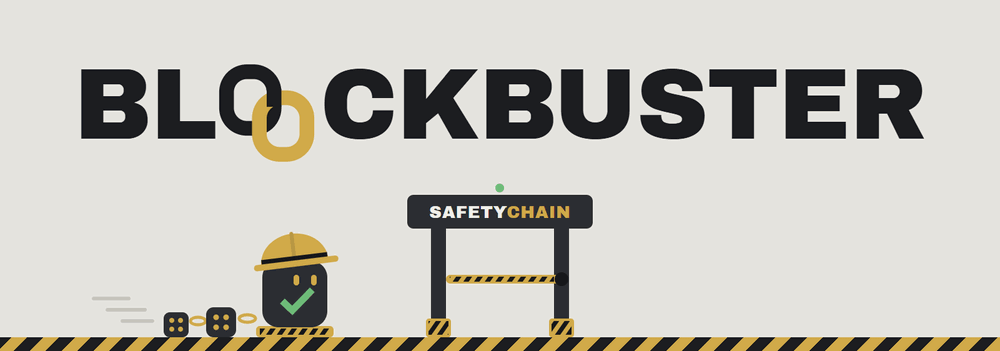

<p align="center">
  

</p>


<div align="center">


# SafetyChain

[](https://github.com/seohee0605/SafetyChain/actions/workflows/ci.yml)

**AI가 검사하고 블록체인이 지키는 현장 안전기록**


[왜 만들었나](#왜-만들었나) · [아키텍처](#아키텍처) · [기술 스택](#기술-스택) · [폴더 구조](#폴더-구조) · [로컬 실행](#로컬-실행) · [주요 기능](#주요-기능)

</div>

---

건설현장 출입 게이트에서 AI가 안전모·안전화 착용을 판정하고, 그 결과를 게이트 기기의 전자서명(EIP-712)과 함께
이더리움(Sepolia)에 기록합니다. 시공사가 기록을 빼면 감리 화면에 드러나고, 현장의 하루 기록은
시공사 → 감리 → 발주처가 각자 서명해야 확정됩니다.

2026 블록체인 AI 융합 해커톤 본선 9팀 블록버스터 (임서희 · 박영서 · 백채원 · 장민준)

### 어떤 위협을 어떻게 막나

| 위협 | 방어 |
|---|---|
| 시공사가 불합격·위험 기록을 몰래 뺀다 | 게이트가 서명한 원본을 감리 감사 저장소에 따로 보내고, 게이트 원본 · 시공사 DB · 블록체인을 3자 대조해 미제출을 드러냅니다. 기기별 일련번호(`deviceSeq`)로 빠진 번호도 체인이 공개합니다 |
| 사고 뒤에 기록을 고쳐 쓴다 | 판정 결과 · 모델 해시 · 사진 해시를 기기 서명과 함께 온체인에 저장하고, 위험성평가는 해시를 남깁니다. 검증뷰가 DB 원본과 사진을 온체인 값과 대조합니다 |
| 시공사 혼자 기록을 확정한다 | 시공사 제출 → 감리 승인 → 발주처 승인을 각자 MetaMask로 서명해야 확정되고, 서버에는 감리·발주처 키가 없습니다 |
| 관리자가 권한을 임의로 준다 | `DEFAULT_ADMIN_ROLE`이 아무에게도 없고, 서명자 등록은 시공사 제안 + 감리 또는 발주처 승인이 있어야 합니다 |
| 오래된 기록·재사용 QR을 끼워 넣는다 | 1회용 nonce, QR 유효기간 최대 5분, 서명 후 3분 이내만 정상, 24시간까지는 감사용 지연 기록, 앞선 시각은 의심 기록으로 분류합니다 |
| 감독자가 불합격을 그냥 통과시킨다 | 수동 처리는 보호구 불합격만 1회, 사유 코드와 서명이 필요합니다. 음주 불합격 · 평가 전 보류 · 지연 · 의심 기록에는 쓸 수 없고 현장 통계에 집계됩니다 |
| 남의 사번으로 QR을 받아 대리 출입한다 | 근로자 앱은 감독자 대면 확인 초대 코드로 등록하고, 이후 폰의 패스키(Face ID)로만 로그인합니다. 서버는 공개키만 보관하고, QR 발급·내 기록 조회는 로그인한 본인 사번으로만 됩니다 |
| 개인정보·음주 수치가 새어 나간다 | 음주는 통과 여부(`bool`)만 저장하고, 실명·연락처는 온체인에 올리지 않으며 날짜별 가명만 씁니다 |

## 현재 상태 (2026-11-02)

- **멘토링 반영**
  - 1차(기획·BM)·3차(출입통제 컨트랙트): 저장 후 분류, 기록별 시간 기준, QR 유효기간 검사, 기록 누락 탐지(게이트 분리·기기 일련번호·감리 감사 저장소),
    위험성평가 전 출입 보류, 이중 서명 예외 출입, 날짜별 가명, 감리·발주처 MetaMask 서명
  - 4차(비전 AI): 모델 교체, 3단계 판정(통과·감독자 확인·차단), 1초 4프레임 판정, policyHash 기록, Override 사유 4 "AI 저신뢰",
    안전화는 "AI는 작업화로 보이는지까지, 판정은 감독자" 원칙
  - 근로자 본인 확인: 근로자 앱을 분리하고 패스키(Face ID)로 로그인. 남의 사번으로 QR을 받아 대리 출입하는 것을 차단 (1차 자격 대여 지적)
- **AI**: 안전모·안전화를 [killuminati1/construction-ppe-yolov8](https://huggingface.co/killuminati1/construction-ppe-yolov8) 한 모델로 판정하고,
  사람 찾기는 YOLOv8n(COCO)을 씁니다. 파인튜닝은 하지 않았습니다.
  - 임계값: 안전모 점수 0.5144 이상 통과, 0.3256 미만 차단, 그 사이는 감독자 확인. 팀이 직접 찍은 평가셋에서 "놓침 ≤ 5%를 먼저 맞추고 차단을 최소로" 정했습니다.
  - 측정 결과(평가셋 266장 · 8개 세션, 세션 하나씩 빼고 검증): 사진 한 장 기준 안전모 놓침 13.2%, 착용자 차단 18.7%, 감독자 확인 10.3%로
    채택 기준(놓침·차단 각 5%·10%)에 못 미칩니다. 놓침 17건 중 14건이 일반 캡(함정 사례)입니다.
  - 영상 20개로 1초 4프레임 판정을 재면 놓침 0/90(0%), 차단 1.6%, 감독자 확인 11.4%로 줄어듭니다. 게이트는 이 방식으로 판정합니다.
  - 안전화는 평가셋에서 어떤 방식도 기준을 넘지 못해(하단 크롭 재추론 포함) 자동 판정 구간을 닫고 전부 감독자 확인으로 둡니다.
  - 모델 가중치와 임계값을 묶은 policyHash가 출입 기록마다 체인에 남아, 판정 기준을 몰래 바꾸면 검증 화면에서 드러납니다.
  - 평가 스크립트: `gate/eval_selfset.py`(평가셋), `gate/eval_video.py`(1초 4프레임), `gate/eval_ppe.py`·`gate/eval_shoes.py`(공개 데이터)
- **테스트**: 컨트랙트 테스트 95개(`forge test`) · E2E 스모크 40개(`scripts/e2e/smoke.py`) · 둘 다 CI에서 매번 실행
- **Sepolia**: `0x3E932e3915e1258f6e1b781112e59744A6847d73` (11/1 재배포: Override 사유 4 "AI 저신뢰" 추가. 이전 배포 `0x082f20bC3dCcFB393bed97Cdc75E6C2DFd2f4d05`).
  시간 기준(정상 3분, QR 최대 5분, 지연 기록 24시간)은 Sepolia 실측(출입 기록 32건, 서명 → 블록 포함 중앙 8초·최대 32초)으로 정했고,
  이 배포본에 그대로 들어가 있습니다 (`CHECKIN_ON_TIME`=180, `MAX_QR_TTL`=300, `CHECKIN_LATE_LIMIT`=86400, `OVERRIDE_REASON_MAX`=4).
- **남은 과제**: 모델·판정 정책 교체를 시공사 제안 → 감리 승인으로 처리하는 절차(4차 제안, 지금은 policyHash 기록·검증까지),
  국내 현장 데이터로 일반 캡 놓침 줄이기, 출입 기록 가스 줄이기(현재 1건 약 140만 gas), 게이트 키를 하드웨어 보안 칩에 두는 구조, 감독자 로그인.
- **라이선스**: Ultralytics YOLO와 평가에 쓴 Construction-PPE 데이터는 AGPL-3.0입니다. 이 저장소는 공개 저장소라 조건을 충족합니다.

## 왜 만들었나

건설현장의 안전검사·위험성평가 기록은 사고가 발생한 뒤에 사후적으로 다시 작성되거나
수정되는 경우가 반복적으로 지적됩니다. 종이·엑셀·사내 시스템 기반 기록은 관리자가
사후에 얼마든지 고쳐 쓸 수 있어, "그 시점에 실제로 그렇게 기록돼 있었는가"를 증명할
방법이 없습니다. 기록을 블록체인에 남기더라도 시공사가 혼자 기록하고 제출한다면
"스스로를 증명하는 구조"라는 한계가 남습니다.

SafetyChain은 검사 결과에 게이트 기기가 서명하고, 그 원본을 감리 쪽에도 따로 보내며,
기록 확정에 감리·발주처의 서명을 요구해 이 문제를 구조적으로 막습니다.

## 절대 원칙

1. **감시 대상은 노동자가 아니라 회사다** — 개인을 지목하는 UI를 만들지 않는다
2. **음주 측정 수치는 온체인·로그 어디에도 남기지 않는다** — `alcoholPass: bool`만 저장
3. **실명·연락처는 온체인에 절대 올리지 않는다** — `workerId = HMAC-SHA256(비밀키, 사번|현장|작업일)`
   날짜별 가명만 온체인에 가서 장기간 출근 패턴이 이어지지 않고, 실명 매핑은 오프체인 SQLite에만 존재

## 아키텍처

```
[작업자] → QR(1회용 nonce) 발급 → [키오스크 웹캠] → [게이트 기기 서비스] YOLO 안전모·안전화 판정
    → 게이트 기기 키로 EIP-712 서명 (판정 결과 + 모델 해시 + 사진 해시 + QR 유효기간 + 기기 일련번호)
    → 감리 감사 저장소로 사본 전송 → 시공사 릴레이가 [SafetyGate 컨트랙트]에 제출
    → 컨트랙트가 출입 상태(허가·불합격·보류·지연·의심)를 정함 → 확정된 뒤에만 게이트 결과 표시
    → 보호구 불합격이면 [감독자] 사유 코드와 함께 수동 처리 (음주 불합격은 불가)

[감독자] 위험성평가 작성 → 원문은 SQLite, 해시만 온체인 (SiteRecord)

[감리 감사] 게이트 원본 · 시공사 DB · 블록체인 3자 대조 → 미제출·바꿔치기·DB 조작 표시
[예외 출입] 게이트 고장·응급 시 감독자 서명 + 감리(또는 발주처)가 자기 지갑으로 공동 서명

[케이스 확정] 현장·작업일 단위
    시공사 감독자 제출 → 감리 승인 → 발주처 승인 = 확정 (감리·발주처는 각자 MetaMask로 서명, 서버는 키 없음)
    반려(사유 코드) 시 보완 후 재제출, 모든 이력이 온체인에 남음
```

### 역할 (컨트랙트가 강제)

| 역할 | 누구 | 서명할 수 있는 것 |
|---|---|---|
| `CONTRACTOR_ADMIN_ROLE` | 시공사 운영 관리자 (릴레이) | 서명자 등록 제안, 비상 해제 |
| `GATE_DEVICE_ROLE` | 게이트 기기 | 체크인만 |
| `SUPERVISOR_ROLE` | 시공사 현장 감독자 | 위험성평가, 수동 처리, 케이스 제출 |
| `INSPECTOR_ROLE` | 감리 (자기 MetaMask) | 서명자 등록 승인, 케이스 1차 승인/반려, 예외 출입 공동 서명 |
| `OWNER_ROLE` | 발주처 (자기 MetaMask) | 서명자 등록 승인, 케이스 최종 승인/반려, 예외 출입 공동 서명 |

- `DEFAULT_ADMIN_ROLE`은 아무에게도 없어서 `grantRole`로 역할을 임의로 줄 수 없습니다.
- 게이트 기기·감독자는 시공사가 제안하고 감리 또는 발주처가 승인 서명을 해야 등록됩니다.
- 출입 기록은 거부 대신 저장 후 분류합니다: 서명 후 3분 이내 정상, 24시간까지는 지연 도착(감사용, 출입 근거 X),
  1~10분 앞선 시각은 의심 기록, 그 밖은 거부(`StaleTimestamp`). QR 유효기간은 최대 5분입니다.
  위험성평가·수동 처리·케이스 승인은 1시간 안에 제출해야 합니다.
- 시간 기준은 Sepolia 실측으로 정했습니다 (2026-10-27, 출입 기록 32건): 서명 → 블록 포함 중앙 8초, 95% 20초, 최대 32초.
  릴레이는 60초까지 확정을 기다리고(`RECEIPT_TIMEOUT`), 넘으면 거부가 아니라 '확정 대기'로 처리해 게이트 화면이 계속 확인합니다.
  다시 재려면 서비스 4개를 켠 뒤 `cd backend && python measure_sepolia.py all` (결과는 `backend/measure_out/`).
- 당일(KST) 위험성평가가 체인에 없으면 출입 기록은 "평가 전 보류"로 남고, 감독자 수동 처리로도 풀 수 없습니다.
- 게이트 기기는 기록마다 일련번호(`deviceSeq`)를 서명합니다. 체인은 기기별 빠진 번호(`missingCount`)를 공개하고,
  서명자 해제는 사유 코드·해제 시점 번호와 함께 이력(`getRevocations`)으로 남습니다.
- 검증뷰는 DB 원본·사진을 DB끼리가 아니라 온체인 저장값과 대조합니다.

## 기술 스택

| 레이어 | 스택 |
|---|---|
| 컨트랙트 | Solidity 0.8.24 + Foundry + OpenZeppelin AccessControl |
| 체인 | Anvil (개발) / Sepolia (데모) |
| 백엔드 | Python 3.11 + FastAPI + web3.py + eth-account (시공사 백엔드·게이트 서비스·감사 저장소 3개) |
| DB | SQLite |
| 프론트 | Vite + React + TypeScript + viem + Tailwind |
| AI | Ultralytics YOLO 사전학습 모델 (killuminati1/construction-ppe-yolov8 + YOLOv8n, 파인튜닝 없음) |

## 폴더 구조

```
safetychain/
├─ contracts/          # Foundry
│  ├─ src/SafetyGate.sol
│  ├─ test/SafetyGate.t.sol
│  └─ script/Deploy.s.sol
├─ backend/            # 시공사 백엔드 (포트 8000): QR·릴레이·위험성평가·케이스. 게이트 기기 키 없음
│  ├─ main.py
│  ├─ chain.py         # web3 연동 + EIP-712 서명 + 릴레이
│  └─ db.py            # SQLite
├─ gate/               # 게이트 기기 서비스 (포트 8200): 기기 키·일련번호·YOLO
│  ├─ main.py
│  ├─ vision.py        # YOLO 추론 (가중치는 gate/models/)
│  └─ eval_ppe.py, eval_shoes.py  # 게이트 판정 단위 AI 평가
├─ audit/              # 감리 감사 저장소 (포트 8100): 3자 대조
├─ ai_eval/            # 공개 데이터 상자 단위 모델 평가
└─ frontend/           # Vite + React
   └─ src/pages/{Gate,SiteRecord,CaseReview,Dashboard,Audit,Verify,Worker}.tsx
```

## Sepolia 배포·데모 준비 순서

1. **지갑 준비**: MetaMask에 감리용·발주처용 계정을 하나씩 만든다 (ETH 필요 없음, 서명만 함).
   릴레이 계정(배포·가스 지불)에만 Sepolia ETH를 넣는다.
2. **배포**: 위 "1. 컨트랙트"의 명령을 `--rpc-url <Sepolia RPC>`로 실행. `INSPECTOR_ADDRESS`·`OWNER_ADDRESS`에 1번 MetaMask 주소.
   출력된 `SafetyGate deployed at:` 주소를 적어 둔다. 감리·발주처 주소는 배포 때 고정되어 바꿀 수 없다.
3. **ABI·주소 반영**: `contracts/out/SafetyGate.sol/SafetyGate.json`의 `abi`를 `backend/abi`, `audit/abi`, `frontend/src/abi`에 복사
   (이 저장소에는 이미 최신 ABI가 들어 있음). 새 주소를 `backend/.env`, `gate/.env`, `audit/.env`의 `CONTRACT_ADDRESS`와
   `frontend/src/config.ts`의 `CONTRACT_ADDRESS`, `RPC_URL`에 넣는다.
4. **환경 변수**: `backend/.env`에 `REVIEWER_SIGNING=wallet`, `INSPECTOR_ACCOUNT=감리:<주소>`, `OWNER_ACCOUNT=발주처:<주소>`,
   `DEVICE_ADDRESS`. `INSPECTOR_SIGNER`·`OWNER_SIGNER`·`DEVICE_PRIVATE_KEY`는 지운다. 기기 키는 `gate/.env`에만.
5. **서비스 실행**: 백엔드(8000) · 감사 저장소(8100) · 게이트(8200) · 프론트(5173).
6. **서명자 승인**: 감리 감사 탭 → 현장 ID 입력 → "지갑 서명 대기"에서 게이트 기기·감독자 등록을 감리 MetaMask로 승인.
   승인 전에는 게이트 검사가 `MissingRole`로 거부된다.
7. **리허설**: 위험성평가 → 게이트 검사 → 케이스 제출 → 감리 지갑 승인 → 발주처 지갑 승인,
   예외 출입 요청 → 감리 감사 탭에서 지갑 공동 서명, 릴레이 중단 → 감리 화면 누락 표시.
8. **백업**: 데모 중 지갑 문제가 생기면 `backend/.env`를 `REVIEWER_SIGNING=server`로 바꾸고
   `INSPECTOR_SIGNER`·`OWNER_SIGNER`에 키를 넣어 서버 서명으로 진행할 수 있다 (화면에 "백업 모드"로 표시됨).

## 로컬 실행

검증된 개발 환경 버전 (CI도 같은 버전으로 돈다):

| 도구 | 버전 |
|---|---|
| Foundry (forge) | 1.8.1 |
| OpenZeppelin Contracts | v5.7.0 |
| forge-std | v1.16.2 |
| Python | 3.11 |
| Node.js | 26 (`frontend/.nvmrc`) |

파이썬 패키지 버전은 각 서비스의 `requirements.txt`에 고정돼 있다.

### 1. 컨트랙트

```bash
cd contracts
forge install foundry-rs/forge-std@v1.16.2 OpenZeppelin/openzeppelin-contracts@v5.7.0 --no-git
anvil                                   # 별도 터미널에서 로컬 체인 실행
forge test                              # 95개 테스트

# 배포 + 게이트 기기/감독자 등록 "제안" (승인은 배포 후 감리가 감리 감사 화면에서 지갑으로)
export DEVICE_ADDRESS=0x...             # 게이트 기기 주소 (gate/.env의 DEVICE_PRIVATE_KEY 주소)
export ADMIN_SIGNER_ADDRESSES=0x...     # 감독자 주소(콤마)
export INSPECTOR_ADDRESS=0x...          # 감리 MetaMask 주소 (키는 넘기지 않음)
export OWNER_ADDRESS=0x...              # 발주처 MetaMask 주소
forge script script/Deploy.s.sol:DeployScript --rpc-url http://127.0.0.1:8545 --broadcast --private-key <릴레이 키>
# (로컬 테스트용) INSPECTOR_ADDRESS 대신 INSPECTOR_PRIVATE_KEY를 주면 스크립트가 승인까지 한다
```

### 2. 시공사 백엔드

```bash
cd backend
pip install -r requirements.txt
cp .env.example .env                    # CONTRACT_ADDRESS, 각 역할 키 (SENDER_PRIVATE_KEY = 배포한 릴레이 키)
uvicorn main:app --reload               # 포트 8000
```

게이트 기기 키(`DEVICE_PRIVATE_KEY`)는 이제 `gate/.env`에만 넣고, 여기에는 `DEVICE_ADDRESS`만 둡니다.
사고 조사용 열람 API를 쓰려면 `INVESTIGATOR_TOKEN`을 채웁니다 (비우면 꺼짐). 검사 사진은 암호화돼 저장됩니다.

### 2-1. 게이트 기기 서비스

```bash
cd gate
pip install -r requirements.txt
cp .env.example .env                    # CONTRACT_ADDRESS, DEVICE_PRIVATE_KEY
mv ../backend/models/*.pt models/       # 예전에 backend/models에 받아둔 YOLO 가중치를 옮김
uvicorn main:app --port 8200
```

키오스크(게이트 화면)는 시공사 백엔드가 아니라 이 서비스로 검사를 보냅니다.

### 3. 감리 감사 저장소

시공사 백엔드와 별도 프로세스·별도 DB로 띄우는 감리 쪽 서비스입니다. 게이트가 서명한 기록 사본을
체인 제출 전에 직접 받아 보관하고, 체인 값과 대조해 미제출·바꿔치기를 드러냅니다.

```bash
cd audit
pip install -r requirements.txt
cp .env.example .env                    # CONTRACT_ADDRESS (시연 때는 AUDIT_GRACE_SECONDS=30 권장)
uvicorn main:app --port 8100
```

백엔드 `.env`의 `AUDIT_URL`이 이 주소를 가리켜야 합니다. `DEMO_CONTROLS=1`이면 감리 감사 화면에서
릴레이 중단·불합격만 누락·기기 해제/재등록을 시연할 수 있습니다.

### 4. 프론트엔드

```bash
cd frontend
npm install
npm run dev                             # http://localhost:5173
```

### 5. 근로자 앱을 아이폰으로 열기 (패스키 · Face ID)

근로자 앱은 관리 화면과 분리된 별도 앱(`worker.html`)이다. 패스키는 **https 또는 localhost**에서만 동작해서,
폰에서는 cloudflared 임시 터널로 https 주소를 만든다 (무료, 계정 불필요).

```bash
brew install cloudflared                          # 한 번만
cd frontend && npm run dev                        # 5173 (백엔드는 8000에서 실행 중이어야 함)
cloudflared tunnel --url http://localhost:5173    # 출력되는 https://xxxx.trycloudflare.com 주소를 복사
```

1. **현장 등록 (감독자)**: 관리 화면 `#/gate` → 시연 도구 → "현장 등록 · 근로자 초대 코드"에서 사번·현장·감독자를 고르고 초대 코드 발급
2. **근로자 등록 (아이폰)**: Safari로 `https://xxxx.trycloudflare.com/worker.html` → 사번·현장 ID·초대 코드 → **Face ID로 등록** → 동의
   (공유 버튼 → "홈 화면에 추가"를 하면 앱처럼 열린다)
3. **출입**: 근로자 앱에서 Face ID로 로그인 → 출입 QR → 키오스크(`#/gate`)에서 "QR 스캔 시작". QR 하나에 사번·현장·nonce가 들어 있다

- https로 열면 근로자 앱은 같은 주소의 `/api`로 요청하고 Vite가 백엔드(8000)로 넘긴다 (`vite.config.ts`).
- 임시 터널 주소는 실행할 때마다 바뀐다. 패스키는 주소에 묶이므로, 주소가 바뀌면 새 초대 코드로 다시 등록한다.
- 백엔드 `.env`의 `WORKER_ORIGINS`에 터널 주소 패턴(`https://*.trycloudflare.com`)이 있어야 한다 (기본값에 포함).
- 예전 방식(사번만으로 QR 발급)이 필요하면 백엔드 `.env`에 `WORKER_AUTH=off`. 이때만 키오스크의 "QR 발급 (예전 방식)"이 동작한다.

데모 영상용 준비 사진 모드는 `?demo`를 붙여서 연다 (`http://localhost:5173/?demo#/gate`).

## E2E 스모크 테스트

로컬 체인(anvil)에 컨트랙트를 새로 배포하고 시공사 백엔드·게이트·감리 감사 저장소를 실제로 띄워서,
출입 기록이 게이트 → 감사 저장소 → 시공사 릴레이 → 체인으로 흐르는 전체 경로를 한 번에 검증한다. CI에서도 매번 돈다.

```bash
backend/.venv/bin/python scripts/e2e/smoke.py      # 약 30초, 실패하면 종료 코드 1
```

- **격리**: 서비스 폴더와 `contracts/`를 임시 폴더에 복사해서 돌린다. 평소 쓰는 DB·키·`.env`·빌드 산출물은 건드리지 않고, 포트도 18545/18000/18100/18200을 쓴다.
- **AI 대역 (기본, CI)**: 복사본의 `gate/vision.py`만 `scripts/e2e/stub_vision.py`로 바꾼다 (YOLO·torch 불필요).
- **실제 AI (`--real-vision`)**: 원본 `vision.py`와 `gate/models/*.pt`로 판정한다. 착용 사진은 통과, 미착용 사진은
  (사람은 찾은 상태에서) 불합격·감독자 확인으로 판정하는지까지 검사한다.

  ```bash
  backend/.venv/bin/python scripts/e2e/smoke.py --real-vision \
    --pass-image frontend/public/demo-helmet.jpg --deny-image <미착용 사진>
  ```
- **검증하는 것**: ABI 동기화 · 위험성평가 → 정상 통과(Granted) · 검증뷰 대조 · 불합격(Denied) → 감독자 Override · QR 재사용 차단 ·
  시공사가 불합격 기록을 숨기면 감리 저장소가 "받을 수 있었는데 안 냄"으로 잡아냄 · 체인의 빈 번호(missingCount) · 감리 화면 집계
- `--keep`을 붙이면 임시 폴더와 서비스 로그를 남긴다.

## 주요 기능

- **근로자 앱 (별도 앱, 패스키)**: 감독자 대면 확인 초대 코드로 등록, 이후 Face ID 로그인. 서버는 공개키만 보관하고 동의·QR·내 기록은
  본인만 접근 (남의 사번으로 QR을 받아 대리 출입하는 것을 차단). 개인정보·민감정보 별도 동의, 1회용 출입 QR, 내 출입 기록(음주 결과는 표시 안 함)
- **게이트 키오스크**: 처리 단계(검사 → 기기 서명 → 블록체인 기록 → 확정) 표시 후 전체 화면 초록(허용)/빨강(불가)/노랑(감독자 확인)
- **게이트 체크인**: QR(1회용, 발급받은 작업자만 사용 가능) → 촬영 → YOLO 판정 → 기기 서명 → 온체인 기록
- **수동 처리(Manual Override)**: 보호구 불합격만, 감독자 서명 + 사유 코드, 1회만. 현장 통계에 집계
- **일일 위험성평가 앵커링**: 원문은 오프체인, 해시·조치완료 여부만 온체인
- **케이스 3단계 확정**: 시공사 제출 → 감리 → 발주처, 제출 범위(scopeHash) 그대로만 승인 가능, 반려 이력 보존
- **대시보드**: 무사고 일수, 최근 7일 검사율 추이, 불합격·수동 처리 비율 (검사 수치는 온체인 기록 기준)
- **검증뷰**: 서명·DB 기록·사진·모델 해시를 온체인 값과 대조
